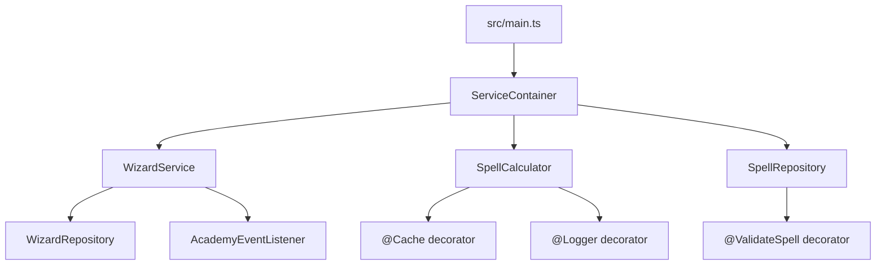

# Hogwarts Academy

Backend-style TypeScript project simulating the Hogwarts Academy wizard management domain.

## What does it do?

- **Wizard management**: create wizards with a name, house and level, and list wizards by house.
- **Spell validation**: the `@ValidateSpell` decorator rejects spells whose power is negative.
- **Spell calculation**: the `SpellCalculator.calculatePower` method is wrapped with `@Cache` and `@Logger` decorators.
- **Academy events**: the `AcademyEventListener` listens to spell cast events emitted by the services.

## Tech Stack

- TypeScript
- Node.js
- Vitest (testing)
- Babel decorators (`@babel/plugin-proposal-decorators`, decorator version `2023-11`)

## Architecture

The project follows a layered architecture with a homemade dependency injection container.



### Layers

- **Entry point**: `src/main.ts` — bootstraps the application through the `ServiceContainer`.
- **Dependency Injection**: `src/DI/service-container.ts` — builds and provides services and repositories.
- **Services**: `src/service/` — business logic (`WizardService`, `SpellCalculator`).
- **Repositories**: `src/repository/` — persistence abstraction (`BaseRepository`, `WizardRepository`, `SpellRepository`).
- **Decorators**: `src/decorator/` — cross-cutting concerns (`ValidateSpell`, `Cache`, `Logger`).
- **Shared**: `src/shared/types.ts` — domain types and enums (`House`, `Spell`, `AcademyEvent`, ...).

### Design patterns

- **Repository pattern**: `BaseRepository<T>` exposes `save` and `getAll`.
- **Decorator pattern**: method decorators add validation, caching and logging concerns.
- **Event-driven**: `AcademyEventListener` extends the Node.js `EventEmitter`.

## Getting Started

```bash
npm install
npm run dev
npm run build
npm run test
npm run test:ci
```

## Testing

Tests live in the `tests/` folder and use Vitest with the Babel decorator plugin configured in `vitest.config.mts`.

```bash
npm run test
npm run test:ci
```
